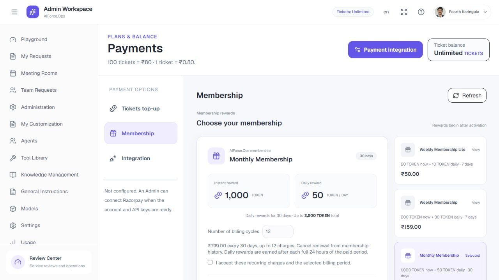

# Payment readiness review — 15 October 2026

The payment code is prepared for organization account setup. It is **not yet approved for accepting real money**: the app remains unconfigured and no real Razorpay account, mandate, bank operation or payment was used in verification.

## Changes delivered

- Preserved the original Monthly, Weekly and Weekly Lite plan layout, prices, reward amounts and calendars.
- Implemented server-backed recurring membership creation with explicit consent and bounded billing cycles; verified price/currency/frequency plan mappings; provider-hosted authorization; signed membership webhooks; authenticated invoice/payment reconciliation; instant and daily rewards, exact caps, renewal, cancellation and history.
- Added missed-response recovery using owned provider references matched to the original receipt/membership notes.
- Added failed/refunded purchase states and check timestamps. Completed/closed purchases cannot reopen for checkout. Concurrent creation is serialized and attempts are limited.
- Added refund review, spending holds and explicit Admin ticket adjustments. Monetary refunds remain a Razorpay Dashboard operation. Refunds stop further rewards for the affected membership cycle.
- Every active role can manage its own billing after a role change; new staff purchases remain blocked. Configuration and refund accounting remain Admin-only.
- Added public merchant policies/support fields and an explicit Live acceptance acknowledgment. Added readiness reporting that separates API verification from observed signed webhook delivery.
- Strengthened fixed-host transport method/path checks, bounded JSON decoding, malformed-payload rejection and sanitized errors.

## Checks

Passed: simultaneous callback/webhook concurrency test using three real database transactions (exactly one credit); production build including TypeScript; scoped ESLint without warnings; ticket payment/database suite; membership billing/database suite; transport suite; HTTP role/route suite; navigation permissions; Admin core action regressions. Database fixtures roll back or remove their exact disposable records. The database migrations 0064–0066 are applied locally and the updated app is running.

Browser verification: all three original plans show the expected price and reward totals; membership consent/cycle controls are present; purchases remain disabled while unconfigured; Admin integration includes Plan IDs, policy fields, readiness status and refund review. No real credential was saved and no external checkout was submitted.

## Required launch work

Follow [Razorpay setup](RAZORPAY-SETUP.md): activated merchant account, matching keys and three Plan IDs, public HTTPS origin, matching signed webhook events/secret, support and policy links. Run real vendor Test flows for capture, failure, repeats, reward posting, renewal, cancellation and refunds. Enable Live only after those pass for the deployment.

Your organization must also own settlement reconciliation, tax invoices/GST, accounting/retention, policy approval, backup/encryption-key recovery, and dispute/chargeback operations. These are not certified or replaced by local automated tests. No automatic dispute adjudication or monetary refund creation is included.

