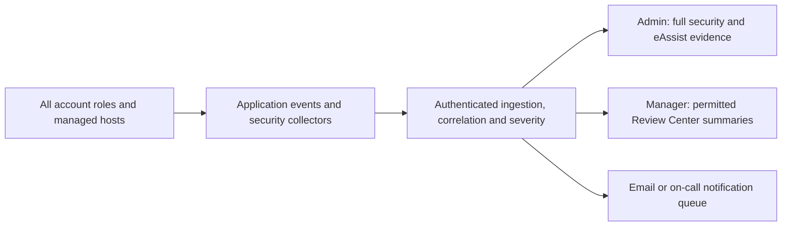

# AIForce.Ops — project readiness review

Reviewed: 7 October 2026 (IST). Source: current local working tree, not a production release.

## Readiness conclusion

The project has working application foundations, persisted employee requests, role boundaries, monitoring adapters and scanner infrastructure. It is **not yet ready to claim complete enterprise operations or the five infrastructure agents in the supplied slide**. ServiceNow and Razorpay are only two of the remaining items. Automatic email, real employee fulfilment, workflow execution, security hardening and production operating evidence also remain.

This review inspected application pages, API handlers, authentication, roles, ticket accounting, organization policies, integration adapters, workers, scanners, ePACE, migrations, tests and deployment documentation. Selected live localhost tests and browser checks were performed. It is not an exhaustive penetration test, a load test, a production deployment certification or proof that external credentials and vendor systems work. Missing functionality below means it was not found in the reviewed implementation; infrastructure supplied outside this repository must be verified separately.

## What is already implemented

| Area | Present in code | Practical limit |
| --- | --- | --- |
| Accounts and roles | User, Employee, Manager and Admin; server authorization; employment confirmation; employee IDs; sessions/password change | Enterprise identity and mail-based recovery remain incomplete |
| Agent Studio | Saved agents, visual graph authoring, tools, knowledge, model selection, publishing and chat | Saved visual graphs are not fully executed |
| Employee services | Guided requests, referrals, resignation and other service forms; persisted status; reviewer decisions and audit records | Approval is an internal decision, not proof of external fulfilment |
| Manager Review Center | Shared organization overview and a separate basic assistant | Does not grant eAssist controls; real source availability determines the readings |
| ePACE | Uploads, retrieval, embeddings, model chat, moderation, evaluation and traces | Enterprise shared project access and incremental knowledge connectors remain |
| Operations integrations | Prometheus, Alertmanager, Semaphore and ServiceNow adapter code | Live connection, routing and complete incident lifecycle need environment validation |
| Security | Organization events, role/rate/origin protections, scanner jobs, ZAP/Trivy results and reports | Baseline scanners are not full protection against all attacks |
| Tickets | User starts with 5; Employee refills to 50; Manager refills to 100 daily in IST; Admin unlimited; audited staff top-ups | Provider cost reservation and concurrency controls need hardening |

Evidence areas: `lib/workspace-access.ts`, `lib/workspace-members.ts`, `lib/employee-playground.ts`, `lib/workspace-decisions.ts`, `lib/manager-review.ts`, `lib/eassist/`, `lib/epace/`, `lib/tickets.ts`, `scripts/security-scanner.mjs`, and `db/migrations/0032_organization_roles.sql` through `0034_daily_ticket_policy.sql`.

## Fresh User information boundary — checked

A disposable new account was tested against localhost with `tests/fresh-user-boundaries.mjs`.

- Default role was User. Staff snapshot had no employee ID, reporting manager, employee requests or request draft.
- Website/Agent Studio guidance remained available.
- Employee, security and administration questions, including an instruction to override the role, stayed in the User response mode with public guidance.
- Direct employee requests, administration, organization, Review Center, eAssist and ePACE data routes returned 403 for that account.
- The User's own Agents route remained available.
- Fixture data was cleaned up after the test.

This confirms the tested paths do not give a fresh User private staff/security data. It does not prove every possible endpoint or future change is safe. Keep these checks in the release pipeline and extend them for cross-account IDs, publication endpoints and all four role sessions. Public website descriptions may explain product capabilities; private alerts, credentials, employee records and operational evidence must remain excluded.

## Remaining features and work

| Priority | Feature | Current state | Work required and acceptance evidence |
| --- | --- | --- | --- |
| P0 | Automatic email | No complete outbound provider/queue/delivery workflow found | Add provider, transactional outbox, templates, retries, deduplication, delivery status and bounce handling. Verify submission, approval/rejection, reminders, onboarding and account recovery with delivered mail |
| P0 | Ticket charging safety | Positive-balance admission followed by post-response debit | Reserve budget atomically before calls; settle actual usage, release failed reservations and prevent concurrent overspending. Define handling when model pricing/FX is unavailable |
| P0 | Consistent change policy | Some chatbot paths are exempted by the API-level write guard | Enforce policy inside every business mutation as well as API entry points; test chat-created requests and role actions with changes disabled |
| P0 | Public agent cost controls | Public chat endpoint bills its publication owner | Add configurable publication authentication, client quotas, owner spending caps and revocation. Admin unlimited internal tickets must not become unlimited public provider spend |
| P0 | Authentication hardening | Basic account/session flows exist | Configure verification and password-reset mail, MFA for privileged accounts, recovery rules and identity-provider/SSO support as required |
| P0 | Deployment operation | Local app and worker/scanner code exist | Deploy always-on workers; verify secrets/TLS/network boundaries, health checks, release migrations, restart recovery, backups and a successful restore exercise |
| P0 | Dependency remediation | Production audit has moderate entries | Review the parsing dependency chain, choose a compatible fix/replacement and rerun document import tests plus audit |
| P1 | ServiceNow | Adapter exists | Configure a real instance, credentials and ACLs; test ingestion and authorized creation/update, alert correlation and resolution. Implement any missing orchestration for alert → incident → approved action → verification → closure |
| P1 | Razorpay | Checkout is not connected | Implement orders, signature verification, authenticated webhooks, idempotent payment ledger, refunds, receipts and reconciliation; test sandbox success/failure/replayed events before live use |
| P1 | Workplace fulfilment | Requests and decisions are persisted | Connect HRIS/leave balances and calendars, equipment inventory, access provisioning, meeting-room/calendar services, training and ATS/referral handling. Reconcile external success/failure instead of treating approval as completion |
| P1 | Full agent runtime | Visual graph preview says nodes are not executed | Implement node interpreter, branching, tool execution, sandboxing, retries, checkpoints, approvals, traces and post-action verification |
| P1 | Shared enterprise knowledge | ePACE projects are account-owned | Add project memberships, invitations, document/source ACLs and company knowledge governance; test cross-account isolation and authorized sharing |
| P1 | Knowledge ingestion | Manual uploads exist | Add incremental SharePoint/Confluence/Drive/S3 or database sources as needed, deletion propagation, source freshness and OCR for scanned documents |
| P1 | Upload safety and search scale | Parsing/retrieval exists | Add quarantine/malware checks and isolated parsing; move large retrieval workloads to indexed vector search and verify latency/load behavior |
| P1 | Continuous security delivery | Local events and scanner jobs exist | Connect durable external monitoring, email/on-call notifications, role-authenticated staging scans and CI gates; verify an actual alert reaches the intended recipient |
| P1 | Privacy and retention | Partial maintenance/export exists | Define event/scanner/audit retention, cleanup, export and account deletion coverage across employee/ePACE/security data; protect audit records against tampering |
| P1 | Recruitment management | Published openings and public guidance exist | Add edit/close controls and ATS/application status if recruitment is to run inside the product; do not invent open positions |
| P1 | Release validation | Many targeted tests exist | Add CI orchestration, all-role browser regression, access-control tests, concurrency/load checks, accessibility/responsive checks and rollback validation |
| P2 | Documentation and value evidence | Some older documents describe superseded role behavior | Update setup/roles/migration instructions. Base ROI and executive value claims on measured operational baselines |

### Specific code findings to address

**Write policy:** `lib/organization-security.ts` excludes `/api/playground` and routes ending in `/chat` from its generic mutation check. Chat domain mutations therefore need their own explicit organization write-policy enforcement. This is a consistency gap, not proof that every security control is absent.

**Ticket budgets:** `lib/tickets.ts` checks whether a non-Admin balance is above zero. `lib/model-usage.ts` later subtracts rounded actual cost. Without a reservation, a large call or simultaneous calls can exceed the available balance. A null ticket calculation also skips the debit. The daily refill policy itself is separate from this spending-control issue.

**Graph execution:** `app/agent-builder/[agentId]/preview/page.tsx` explicitly states that chat uses saved instructions/model and visual nodes are not executed. `app/api/published-agents/[publicId]/chat/route.ts` needs an execution runtime before publishing a graph can mean running its workflow.

**Retention/export:** `app/api/account/export/route.ts` does not cover all newer employee/ePACE/security datasets. Maintenance for platform events does not establish a complete retention policy for organization security events, rate-window rows and scanner history.

**Headers and scanning:** A complete CSP/security-header configuration was not found in app configuration. Deployment may provide headers, so verify actual responses. ZAP baseline uses a limited public-route scope; authenticated role and business-logic coverage still need implementation.

**Dependency audit:** `npm audit --omit=dev --json` reported three moderate package entries—`sprintf-js`, `argparse`, and `mammoth`—in one affected dependency chain, with no high or critical entries. The underlying advisory concerns denial of service through precision specifiers. This audit does not establish exploitability in this app. The suggested major-version change points to an older Mammoth version; do not apply a forced downgrade blindly. Raw evidence: `docs/verification/dependency-audit-2026-10-07.json`.

## Comparison with the supplied infrastructure slide

The screenshot is a target capability list, not evidence those capabilities currently run. None of its five specialized agents was found implemented end-to-end.

| Slide use case | Current project foundation | Missing for the stated capability |
| --- | --- | --- |
| Commvault backup failure prediction | Generic alerts, history and automation connections | Commvault job/resource/network collector, labelled failure history, evaluated prediction model, preventive playbooks and verified outcomes |
| Storage Engineer L3 dynamic optimization | Generic monitoring/operations foundation | Vendor controller/pool/volume collectors; IOPS, latency, throughput, cache, CPU and growth analysis; balancing actions with dry-run, approval, rollback and verification |
| Windows L3 server health/performance | Prometheus target availability and alert ingestion | Windows/vSphere metrics and rules for CPU, RAM, disk, network, memory leaks, CPU readiness and reserved/used resources; patch canary, reboot and rollback workflows |
| VCF/Hybrid Cloud security and compliance | General security findings and policy controls | vCenter/SDDC, NSX and vSAN collectors; control baselines, configuration drift, misconfiguration analysis and reviewed remediation with rollback |
| Linux/RHEL health | Generic target health and alerting | Node/systemd collectors; disk pressure, CPU load and failed-service rules; logs, anomaly baselines and RHEL-specific verified remediation |

The slide's productivity percentages cannot be claimed for this project without measured before/after results. For each agent, require a real source, a reproducible detection scenario, an authorized action, a verified recovery and retained evidence.

## Security systems to attach for continuing monitoring

Use layers with different schedules. Runtime protection should stay active; code scanning should run on changes; deeper web scans should run on staging after deployment or on a schedule. Running an active penetration scan on every user's click is not the appropriate architecture.

| System | Purpose and cadence | Project status / attachment work |
| --- | --- | --- |
| Prometheus + Alertmanager | Continuous metric rules, grouped alerts and notification routing | Adapter foundation exists. Configure real targets/rules, always-on services and email/on-call/chat delivery. [Official alerting overview](https://prometheus.io/docs/alerting/latest/overview/) |
| Wazuh | Endpoint/host security telemetry analyzed centrally | New integration. Deploy agents on managed hosts plus a central server/indexer/dashboard; add authenticated ingestion/mapping into AIForce.Ops. Hosting must permit agents or expose equivalent logs. [Official architecture](https://documentation.wazuh.com/current/getting-started/architecture.html) |
| Semgrep | Static code checks in CI on pull requests/builds | New CI integration. Select relevant rules, establish a reviewed baseline and block new serious findings. Feed normalized results into the existing reporting model. [Official CI configuration](https://docs.semgrep.dev/semgrep-ci/sample-ci-configs) |
| Trivy | Vulnerability, configuration and secret checks for build artifacts/source | Existing scanner foundation; extend to deployment images/IaC and CI gates. Redact secrets from evidence. [Official secret scanning](https://trivy.dev/docs/latest/guide/scanner/secret/) |
| OWASP ZAP | Scheduled web scanning, with authenticated staging contexts | Existing passive baseline; extend coverage to all roles with test accounts. Baseline scanning is passive; authenticated and active tests need separate setup. [Baseline](https://www.zaproxy.org/docs/docker/baseline-scan/), [authentication](https://www.zaproxy.org/docs/desktop/start/features/authentication/) |
| CrowdSec with an enforcement component | Edge threat detection and request blocking at a supported proxy | New integration; detection alone does not enforce blocking. Deploy a compatible remediation component, tune false positives and preserve legitimate access. [Introduction](https://docs.crowdsec.net/docs/intro/), [remediation components](https://docs.crowdsec.net/docs/bouncers/intro/) |
| Sentry | Runtime application errors and performance diagnostics | New SDK integration. Scrub cookies, credentials and private records before sending telemetry. This complements security monitoring; it is not an intrusion detector. [Official Next.js SDK](https://github.com/getsentry/sentry-javascript/blob/develop/packages/nextjs/README.md) |

Recommended sequence: complete existing Prometheus/Alertmanager delivery and Trivy/ZAP operation first; add Semgrep CI gates and runtime error collection; add Wazuh for managed infrastructure and edge protection appropriate to the chosen hosting platform. External services and their operating costs are not made free by Admin unlimited tickets.

### All-login protection and alert visibility

Apply central authentication, authorization, rate limits, validation and organization policy to User, Employee, Manager and Admin requests. Attach server-verified actor identity, role, time and affected resource to events. Deduplicate incidents and track notification delivery/retries.

Managers receive basic Review Center information: Observability, Value dashboard, AI Ops, Executive summary, Data sources, Geo health and Service details. eAssist deep controls and sensitive security evidence remain Admin only. Employee/User private records must not leak through shared summaries. An account does not need to see a security dashboard to be protected by security controls.

## Completed during this review

- Restyled Organization controls with aligned inputs and security-policy cards.
- Restyled Recruitment and organization activity into clearer disclosure panels; added activity search.
- Added a styled, searchable audit table with friendly action labels, bounded scrolling and explicit IST dates.
- Admin empty Playground now centers name/role, hides department/pending metadata and adds space before shortcuts. Other staff retain their relevant metadata.
- Fresh User empty welcome no longer renders irrelevant staff metadata.
- TypeScript and targeted ESLint checks passed. Fresh-User boundary tests passed. Browser verified administration layout, recruitment disclosure and audit search (one matching ticket allocation from 28 records).
- No live role assignments, policy changes, external vendor installation, payment or email sending was performed for this review.

## Release acceptance gates

1. Fix and regression-test ticket reservation, chat write-policy consistency and public-owner spending caps.
2. Verify every role and cross-account boundary; configure privileged-account MFA/recovery and safe upload processing.
3. Deliver and retry real transactional emails; demonstrate real integration failure handling and external fulfilment reconciliation.
4. Prove continuous monitoring works when the local developer computer is off; trigger one test alert and verify its receipt, attribution, deduplication and resolution.
5. Run CI tests/scans, a staging authenticated assessment, load tests and an independent security review; address serious findings.
6. Restore a backup, rehearse a release rollback and document operational ownership, retention and incident response.
7. Accept infrastructure agents individually only after their real-source detection/action/verification tests pass. Keep unfinished capabilities explicitly labelled.

These gates distinguish a polished local application from an operationally supported industry deployment.
