# AIForce.Ops ePACE — Page-by-Page File Map

This guide maps the **ePACE website header, CognitiveConnect dashboard, each navigation view, and the separate HR document viewer** to the files that implement them. It follows the page-by-page structure of `SERVICE-REVIEW-CENTER.md`, `AGENT-STUDIO.md`, and `EASSIST.md`: each screen has its own file-location heading and flowchart. Paths in the trees are relative to the `ai-force-ops/` project root.

ePACE is the cognitive platform lifecycle workspace at `/service-review-center/epace`. Its navigation pages are views inside one React workspace, not separate route files. The page entry route is shared; selecting a navigation item changes the active view in `workspace.tsx`.

## Access shared by all ePACE pages

```text
proxy.ts
└── Requires the ePACE knowledge permission on the page and /api/epace routes

lib/workspace-access.ts
lib/workspace-permissions.ts
└── Resolves active workspace membership and knowledge permission

app/api/workspace/access/route.ts
└── Supplies the current member and role used for role-aware workspace links
```

The permission rules currently allow Admins and Managers. Employees need verified employment (`employment_verified_at`). Users and unverified Employees are denied. The application also scopes ePACE projects, records, documents, and audit rows to their owning signed-in user; the Access & Audit view does not grant shared project access. Admin-only integration links remain separately permission-gated.

---

## ePACE Page — file locations

**Page:** ePACE cognitive platform workspace · **Route:** `/service-review-center/epace`

```text
app/service-review-center/epace/
├── page.tsx
│   └── Route entry; requires a signed-in session and mounts EpaceWorkspace
├── workspace.tsx
│   └── Main ePACE shell, view navigation, project state, forms, dialogs, and page rendering
├── loading.tsx
│   └── Loading state while the workspace route loads
├── workspace.css
│   └── ePACE header, sidebar, cards, tables, editor layout, dialogs, and responsive styling
├── project-picker.tsx
│   └── Selects or starts deletion of an account-owned project
└── markdown-editor.tsx
    └── Rich Markdown editor used for questions and document/prompt content

app/api/epace/
├── route.ts
│   └── Loads the signed-in user's project snapshot; validates project and record create/update/delete actions
└── events/route.ts
    └── Streams short-lived project snapshot updates to the workspace

lib/epace/
├── store.ts
│   └── Project/record ownership checks, snapshots, persistence, and audit helpers
├── types.ts
│   └── Project settings, record kinds, run, trace, and readiness data contracts
└── runtime.ts
    └── Provider request limits, token allowance, bounded input, and runtime policy

db/migrations/
├── 0009_epace.sql
│   └── Creates account-owned ePACE projects, records, knowledge chunks, and audit history
└── 0012_epace_production_controls.sql
    └── Adds ePACE production request limits, maintenance health, and supporting indexes
```

The browser loads the selected user's snapshot, opens an event stream, and updates local view state. All project and record mutations are sent to the authenticated API and checked against the signed-in account before storage.

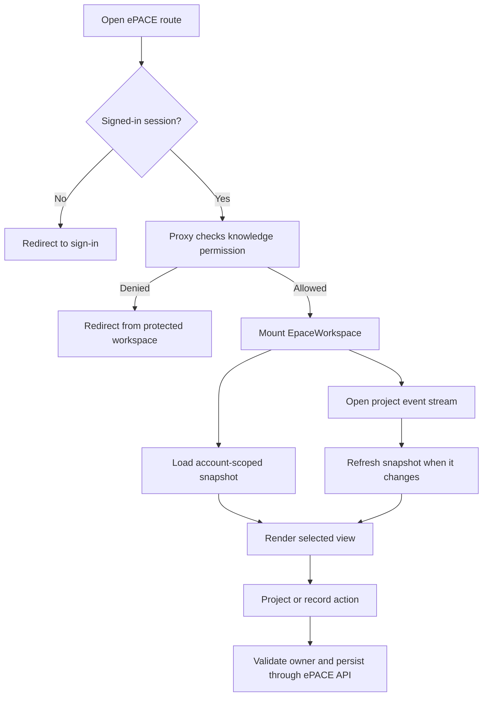

---

## Header of the Website — file locations

The ePACE header shows the ePACE / Cognitive infra identity, the AIForce.Ops platform-lifecycle label, live project update status, the signed-in user's name, and a role-aware link back to Agent Studio or the Review Center. Admins also see the eAssist operations link in the sidebar.

```text
app/service-review-center/epace/
├── workspace.tsx
│   └── Header branding, live/reconnecting indicator, member lookup, and workspace navigation
└── workspace.css
    └── Header arrangement, live status colors, sidebar, and mobile navigation styles

app/api/workspace/access/route.ts
└── Supplies the current role for conditional links

```

The live indicator reflects the ePACE snapshot event stream connection. It is not a health check for OpenAI or the database. The ePACE header displays the signed-in user's name directly; it does not mount the Agent Studio account-menu component.

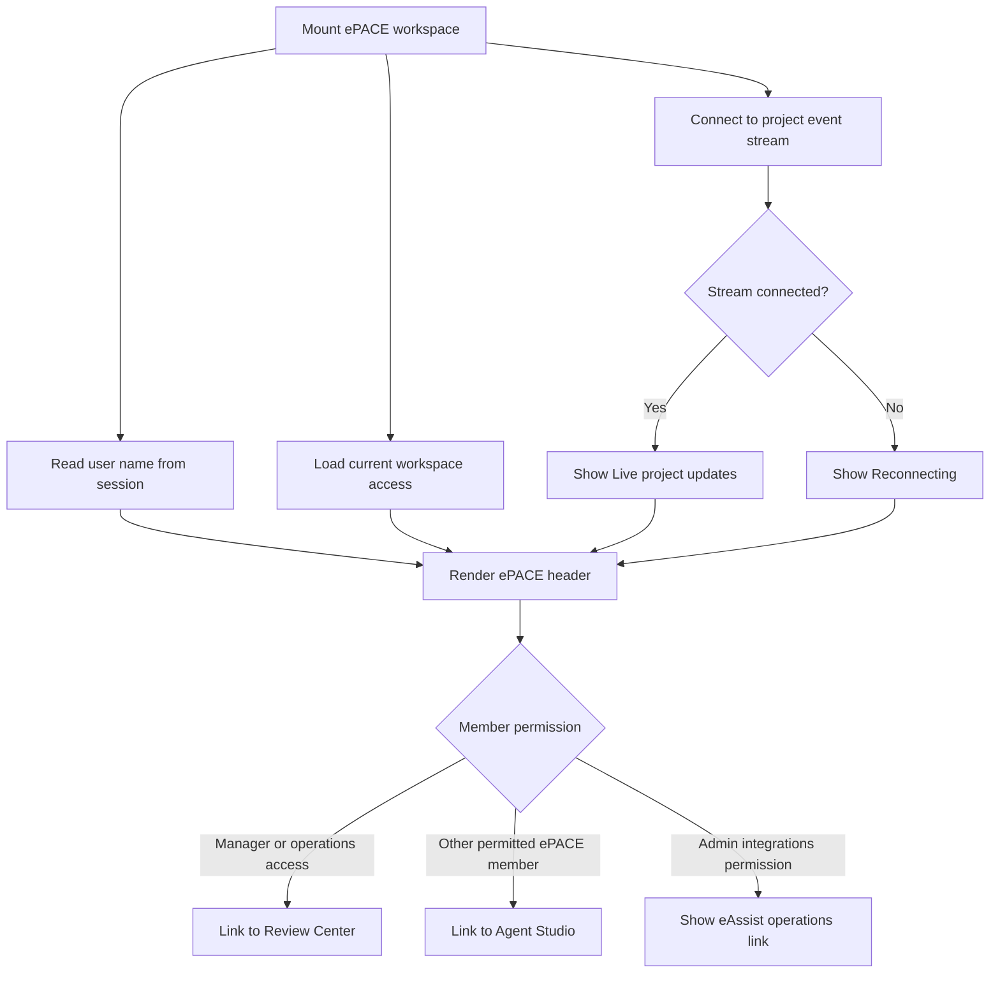

---

## Dashboard — CognitiveConnect Page file locations

**View:** `chat` · **Default view:** CognitiveConnect / “Chat with your data”

```text
app/service-review-center/epace/
└── workspace.tsx
    └── Chat view, thread history, message editor, citations, feedback, and run details

app/api/epace/
└── chat/route.ts
    └── Validates the question, retrieves project knowledge, applies safety/evaluation, calls the configured model, and records the run/thread

lib/epace/
├── engine.ts
│   └── Provider calls, knowledge retrieval, moderation, and model evaluation
├── knowledge.ts
│   └── Knowledge-query handling and retrieval helpers
├── greetings.ts
│   └── Recognizes standalone greeting messages
├── markdown.ts
│   └── Markdown conversion and clipboard formatting helpers
└── store.ts
    └── Persists and reads account-owned chat threads, runs, and audit events

app/api/epace/documents/route.ts
└── Reads the selected project document used to inspect cited source content

app/api/playground/models/route.ts
└── Supplies available model choices used by ePACE settings
```

Questions are answered using the selected project's configured model and project knowledge. A chat run may include retrieval, moderation, evaluation, citations, trace data, token usage, and feedback records. The screen exposes only the sources and records actually returned by that run.

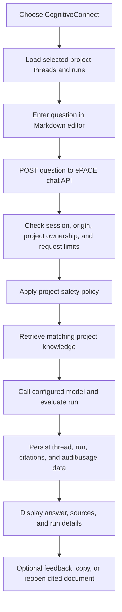

---

## Knowledge & Indexes Page file locations

**View:** `knowledge`

```text
app/service-review-center/epace/
├── workspace.tsx
│   └── Project knowledge table, upload controls, source viewer, and retrieval settings
└── document/page.tsx
    └── Separate private HR Collection document detail page

app/api/epace/
├── documents/route.ts
│   └── Uploads, parses, deduplicates, reads, and deletes supported project documents
└── route.ts
    └── Loads document records and project snapshot

lib/epace/
├── knowledge.ts
│   └── Builds/uses project knowledge retrieval and indexing helpers
├── store.ts
│   └── Enforces project ownership and document record access
└── types.ts
    └── Document and project settings contracts

db/migrations/0009_epace.sql
└── Stores document records and account/project-scoped knowledge chunks
```

Supported uploads are PDF, DOCX, TXT, Markdown, CSV, and JSON (up to 10 MB; readable extracted text is required). The document API extracts text, rejects unsupported or unreadable files, records a content hash to avoid duplicates, and stores project-scoped passages. Semantic embeddings are generated/cached when semantic search first needs them; the upload alone should not be described as proof that an external vector service is configured.

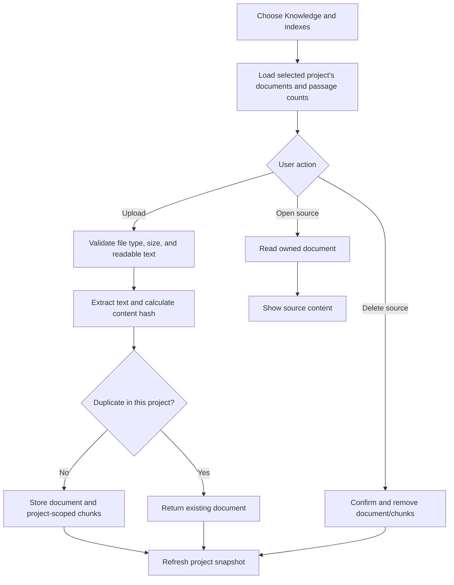

---

## Tracing & Monitoring Page file locations

**View:** `tracing` · **Tabs:** Runs, Threads, Monitor, Setup

```text
app/service-review-center/epace/
└── workspace.tsx
    └── Trace tabs, run/thread tables, filters, performance and feedback views

lib/epace/
├── analytics.ts
│   └── Time-window filtering and run/trace summary calculations
├── types.ts
│   └── Run, span, evaluation, moderation, and thread data contracts
└── store.ts
    └── Reads project-owned traces, runs, and conversations

app/api/epace/
├── route.ts
│   └── Returns the selected project's trace/run/thread records
└── events/route.ts
    └── Notifies the page of changed project snapshots
```

Runs and conversations originate from ePACE activity such as CognitiveConnect questions and safety tests; the workspace notes that it does not populate this screen with imported demo runs. Monitor summarizes recorded data within the chosen time range. Setup displays project ID and configured quality thresholds and links to project settings.

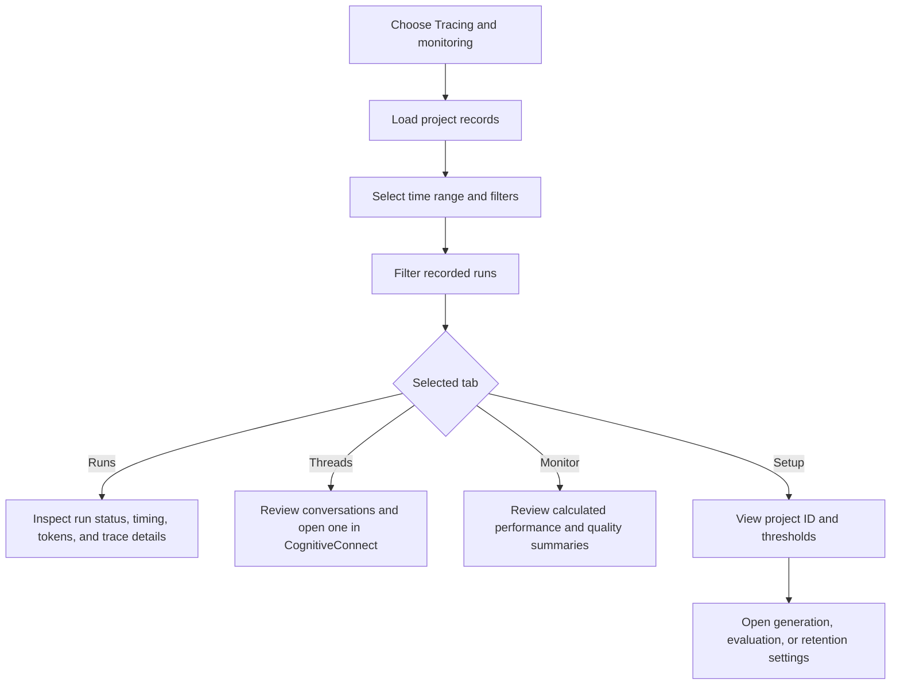

---

## Safety & Security Page file locations

**View:** `safety` · **Tabs:** Content filters, Try it out, Monitor activity

```text
app/service-review-center/epace/
└── workspace.tsx
    └── Safety tabs, filter management, policy tests, and moderation activity

app/api/epace/
├── moderate/route.ts
│   └── Moderates submitted input/output text under the selected project's policy and records the result
└── route.ts
    └── Saves filter records and selected project settings

lib/epace/
├── engine.ts
│   └── Calls the moderation provider and returns the moderation outcome
├── runtime.ts
│   └── Applies provider admission and production policy checks
└── types.ts
    └── Filter, threshold, moderation, run, and alert shapes

db/migrations/
├── 0009_epace.sql
│   └── Persists project filter/run/alert records
└── 0012_epace_production_controls.sql
    └── Supports production request controls
```

The Content filters tab manages project filter records and the active selection. Try it out submits a real moderation request for the selected input/output stage; the result is recorded as a run and a blocked test creates an in-app alert. Monitor activity displays stored moderation/run activity. This is not evidence of an independently configured enterprise security provider.

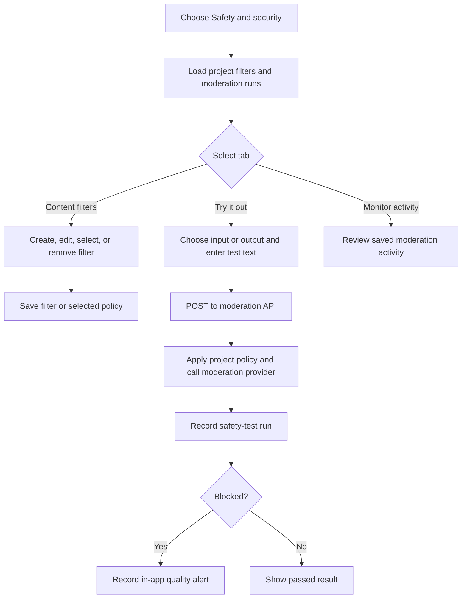

---

## Quality Alerts Page file locations

**View:** `alerts`

```text
app/service-review-center/epace/
└── workspace.tsx
    └── Quality alert list, evaluation thresholds, review state, and alert actions

app/api/epace/
├── route.ts
│   └── Reads and updates project alert, filter, and settings records
└── chat/route.ts
    └── Produces evaluated runs that can create threshold-based alerts

lib/epace/
├── engine.ts
│   └── Runs model evaluation and applies configured evaluation thresholds
├── analytics.ts
│   └── Summarizes stored runs and evaluation outcomes
├── types.ts
│   └── Alert and evaluation data contracts
└── store.ts
    └── Persists project-scoped alerts and audit actions

db/migrations/0009_epace.sql
└── Stores alert records as account/project-owned ePACE records
```

This view reviews alerts created from actual evaluation scores below configured thresholds or safety-policy blocks. It supports an in-app test alert and acknowledging open alerts. Evaluation is sampled according to project settings; unscored runs are not assigned synthetic scores. External email delivery is not connected.

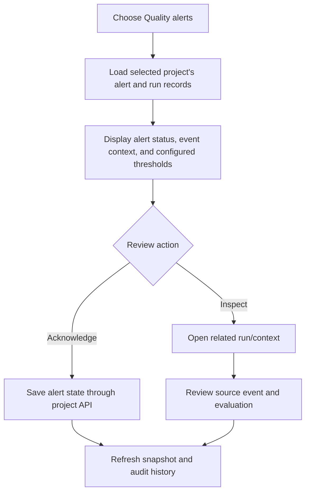

---

## Platform Catalog Page file locations

**View:** `catalog` · **Tabs:** Components, Docs

```text
app/service-review-center/epace/
└── workspace.tsx
    └── Component catalogue, Docs filter, component details, edit/delete, and starter download

app/api/epace/
├── route.ts
│   └── Loads and persists component records
└── scaffold/route.ts
    └── Builds and downloads a ZIP starter for an owned registered component

lib/epace/
├── scaffold.ts
│   └── Generates the component starter archive
├── starter.html
│   └── Starter interface template used by scaffold generation
├── types.ts
│   └── Component record contract
└── store.ts
    └── Validates component/project ownership
```

Components are project records. The Docs tab filters to components with a Documentation URL saved; uploaded project knowledge is managed separately in Knowledge & indexes. A starter download is generated from the selected component data; it does not deploy the service.

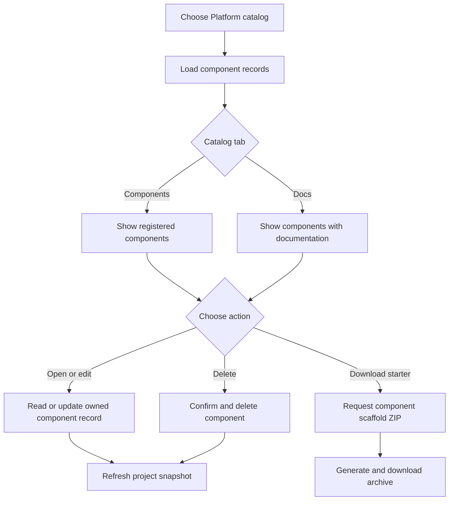

---

## Create Component Page file locations

**View:** `create`

```text
app/service-review-center/epace/
└── workspace.tsx
    └── Component creation form, template selection, save flow, and scaffold download action

app/api/epace/
├── route.ts
│   └── Creates the component and related project records
└── scaffold/route.ts
    └── Generates a ZIP starter from a saved component

lib/epace/
├── scaffold.ts
│   └── Assembles the generated component files
├── starter.html
│   └── Provides the starter UI template
├── types.ts
│   └── Defines component and template record shapes
└── store.ts
    └── Persists component/template records under the owning project
```

The screen supports creating a RAG service from a template or registering an existing component. Saving records the component in the current project. The generated starter can be downloaded afterward; it is scaffolding, not a hosted deployment.

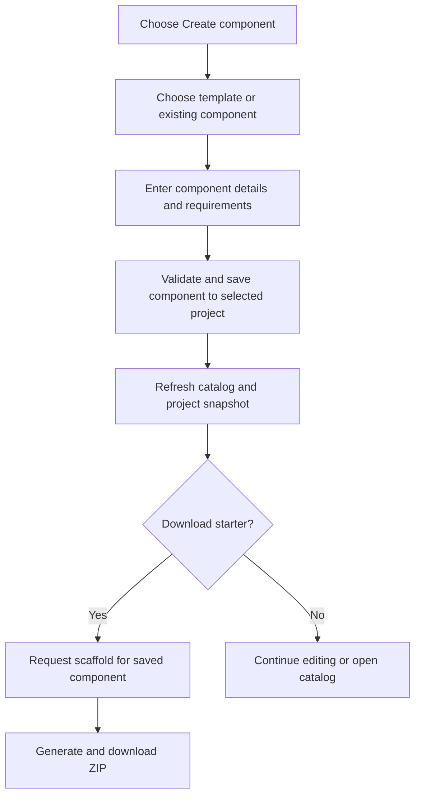

---

## Prompts & Code Assistant Page file locations

**View:** `prompts`

```text
app/service-review-center/epace/
├── workspace.tsx
│   └── Prompt records, prompt editing/version actions, and project-context code assistant
└── markdown-editor.tsx
    └── Formats Markdown prompt content

app/api/epace/
├── route.ts
│   └── Saves prompt records and project settings
└── chat/route.ts
    └── Runs the code-assistant task as a traced, evaluated project conversation

lib/epace/
├── engine.ts
│   └── Executes the configured model and project safety/evaluation pipeline
├── knowledge.ts
│   └── Supplies project knowledge retrieval for grounded assistance
├── markdown.ts
│   └── Markdown serialization and clipboard helpers
└── types.ts
    └── Prompt and run record shapes
```

Saved prompts are project records and can be applied to project settings. The code assistant sends the task through CognitiveConnect with the saved component requirements included as context; resulting conversations are traced and evaluated under the same project policy.

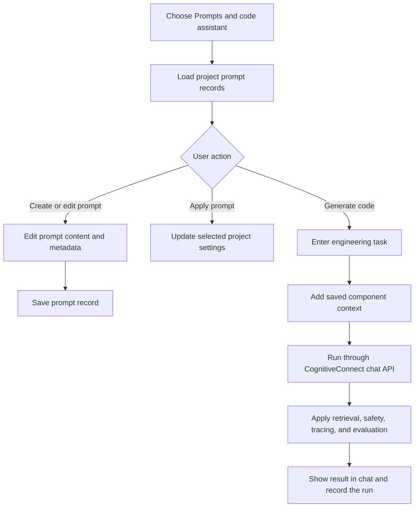

---

## Lifecycle & Assessment Page file locations

**View:** `lifecycle`

```text
app/service-review-center/epace/
└── workspace.tsx
    └── Lifecycle stages, component counts, assessment forms, evidence, export, and workspace links

app/api/epace/
└── route.ts
    └── Persists component and assessment records and project settings

lib/epace/
├── analytics.ts
│   └── Provides shared run/usage summary helpers used by lifecycle/operations views
├── types.ts
│   └── Defines assessment evidence and lifecycle record shapes
└── store.ts
    └── Stores account-owned assessment and component records
```

The lifecycle view groups work into Design & build, Onboard & stabilize, and Operate & improve. Assessments are user-supplied evidence across capability areas; the UI explicitly does not calculate a readiness score without supplied inputs. The eAssist shortcut is Admin-only because eAssist requires the integrations permission.

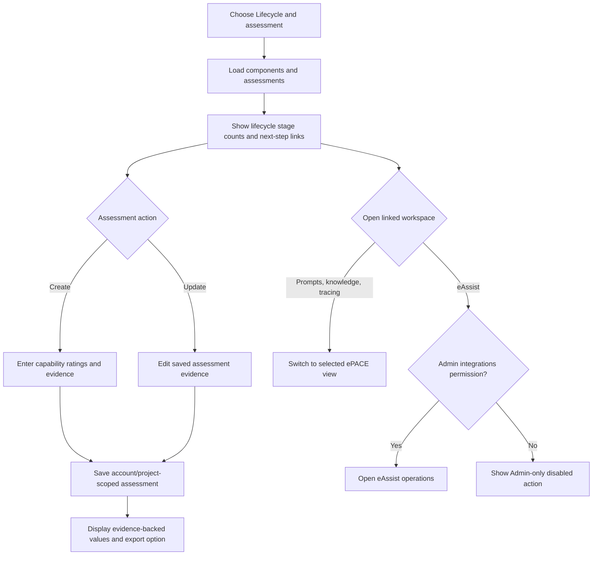

---

## Tech Radar Page file locations

**View:** `radar`

```text
app/service-review-center/epace/
└── workspace.tsx
    └── Adopt/Trial/Assess/Hold technology columns and technology record forms

app/api/epace/route.ts
└── Creates, edits, and deletes project radar records

lib/epace/
├── types.ts
│   └── Defines radar record fields
└── store.ts
    └── Enforces account/project ownership for radar records

db/migrations/0009_epace.sql
└── Persists radar entries as project-owned ePACE records
```

The radar is a workspace-maintained list of technology choices categorized as Adopt, Trial, Assess, or Hold, with description and owner fields. It does not automatically discover or evaluate technologies.

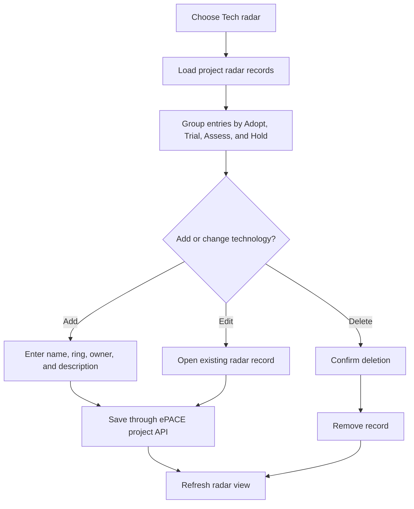

---

## Access & Audit Page file locations

**View:** `access`

```text
app/service-review-center/epace/
└── workspace.tsx
    └── Project owner and account-scoped access explanation, audit history table

app/api/epace/
└── route.ts
    └── Returns only the signed-in owner's project records and audit history

lib/epace/
└── store.ts
    └── Checks project ownership and writes audit events for ePACE actions

db/migrations/0009_epace.sql
└── Defines project ownership and project-scoped audit records
```

This view explains the implemented access boundary and lists the selected project's audit history. It explicitly states that organization membership, shared project roles, and RBAC invitations are not configured here. Changing roles in Agent Studio does not transfer ownership of ePACE projects.

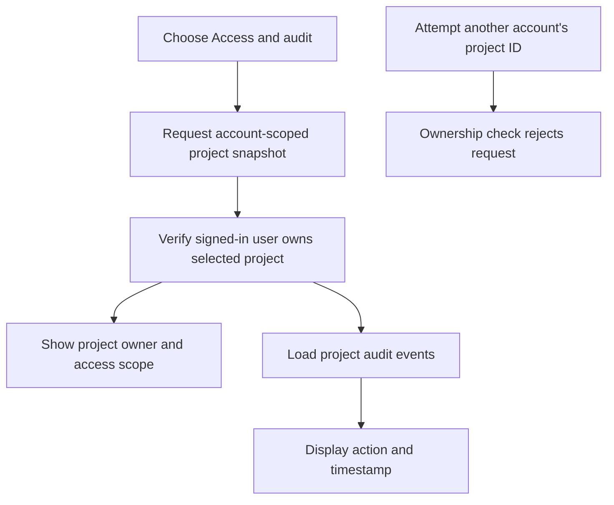

---

## Deployment Readiness Page file locations

**View:** `readiness` · **Entry:** Internal view state; not a standard sidebar navigation item

```text
app/service-review-center/epace/
└── workspace.tsx
    └── ReadinessPanel, checks table, provider-check action, and settings navigation

app/api/epace/readiness/route.ts
└── Reads real project/deployment checks and runs the explicit provider verification action

lib/epace/
├── engine.ts
│   └── Provider, moderation, embedding, and usage helpers used by readiness checks
├── runtime.ts
│   └── Enforces request policy and provider admission limits
├── maintenance.ts
│   └── Maintenance health state
├── types.ts
│   └── Readiness result and check contracts
└── store.ts
    └── Validates project ownership and writes readiness audit events

db/migrations/
├── 0012_epace_production_controls.sql
│   └── Production controls and maintenance health storage
└── 0009_epace.sql
    └── Project settings, knowledge chunks, and audit records inspected by checks
```

Readiness reports observed configuration and system state such as model/provider access, safety configuration, knowledge coverage, evaluation/usage, worker health, maintenance status, signup, and origin policy. The view is implemented in the workspace, but no visible sidebar item or current `chooseView("readiness")` action was found, so it is not reachable through the standard navigation at present. Its API route is available. A provider verification action makes real provider requests and is audited; it can incur provider usage. A readiness report is a diagnostic, not a guarantee that a deployment is production-ready.

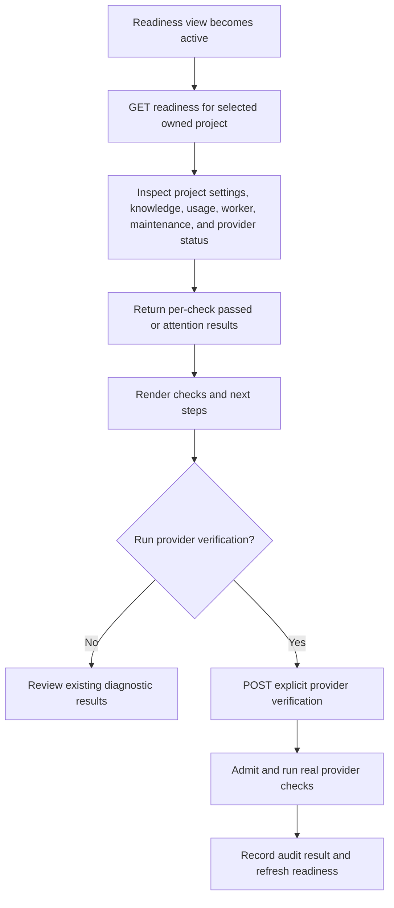

---

## HR Collection Document Viewer — file locations

**Route:** `/service-review-center/epace/document?project=<project-id>&id=<document-id>`

```text
app/service-review-center/epace/document/
└── page.tsx
    └── Checks session, knowledge permission, UUID parameters, ownership, and DWP/HR Collection scope; renders private document text

app/service-review-center/epace/workspace.tsx
└── Opens selected project source documents from the Knowledge & indexes view

lib/workspace-access.ts
lib/workspace-permissions.ts
└── Enforces verified Employee/Manager/Admin access to knowledge pages

db/migrations/0009_epace.sql
└── Stores the project and document record
```

The standalone viewer requires both IDs to be UUIDs and loads a document only when it belongs to the signed-in user's project and that project is marked as a DWP collection or named “HR Collection.” It displays extracted text and offers a link back to Agent Studio. This is a private project document view, not a general-purpose public document URL.

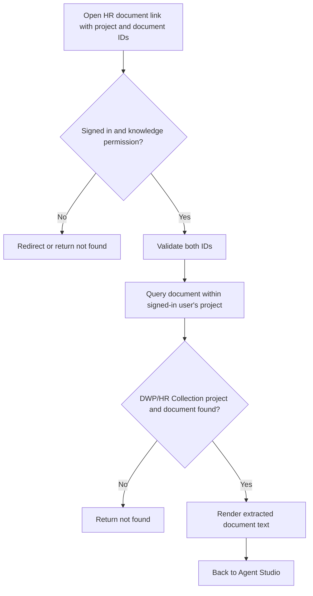

---

## Shared ePACE data and execution flow

```text
Browser view in workspace.tsx
    ├── GET /api/epace?project=<id> ───────┐
    ├── EventSource /api/epace/events ─────┤
    ├── POST /api/epace ───────────────────┤
    ├── POST /api/epace/chat ──────────────┤
    ├── /api/epace/documents ──────────────┤
    ├── /api/epace/moderate ──────────────┤
    ├── /api/epace/readiness ─────────────┤
    └── /api/epace/scaffold ──────────────┘
                    │
                    ▼
              lib/epace/*
    ├── store.ts       owner checks, snapshots, project records, audit
    ├── engine.ts      model, retrieval, moderation, evaluation
    ├── knowledge.ts   project document retrieval
    ├── analytics.ts   recorded-run summaries
    ├── scaffold.ts    component starter archive generation
    ├── runtime.ts     provider limits and production policy
    └── types.ts       shared ePACE records and settings
                    │
                    ▼
              PostgreSQL
    ├── epace_projects
    ├── epace_records
    ├── epace_chunks
    └── epace_audit
```

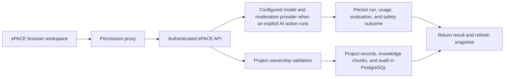
