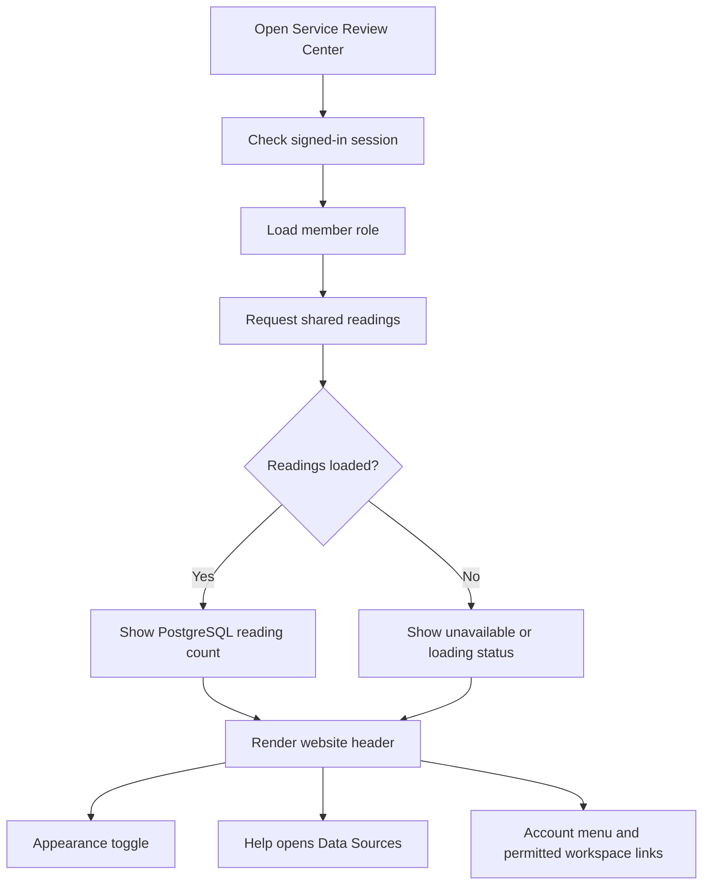
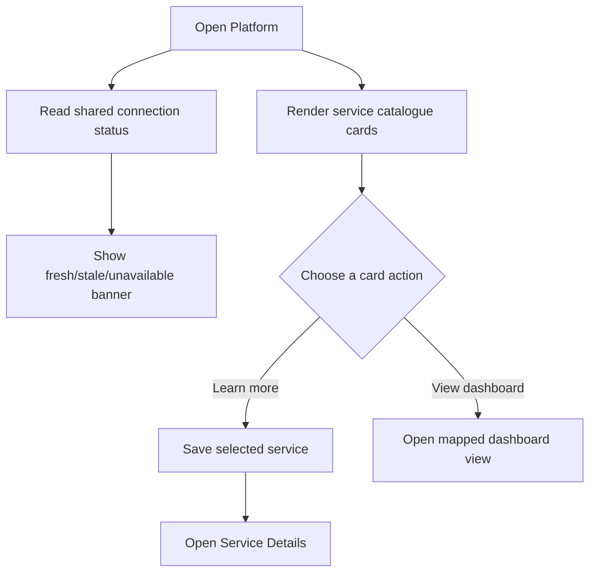
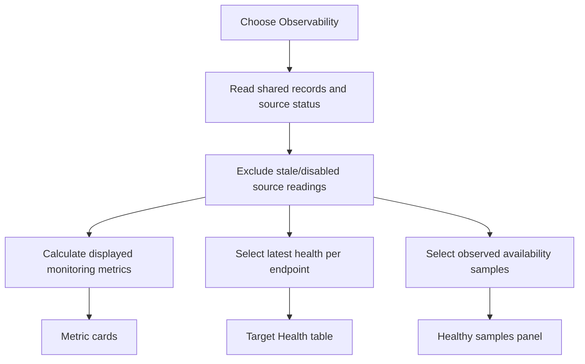
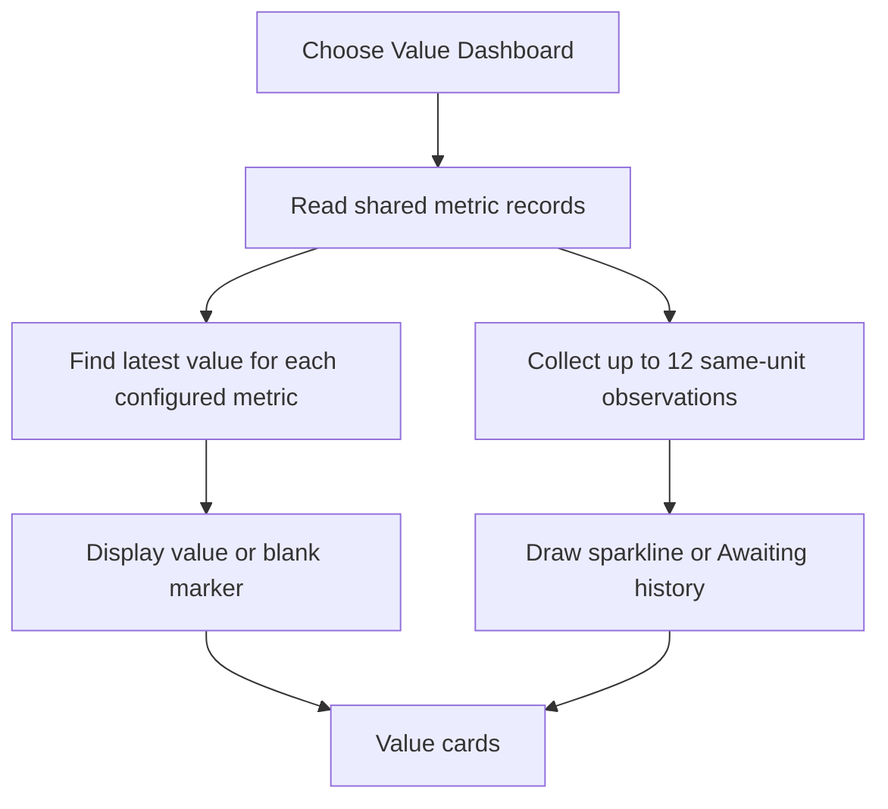
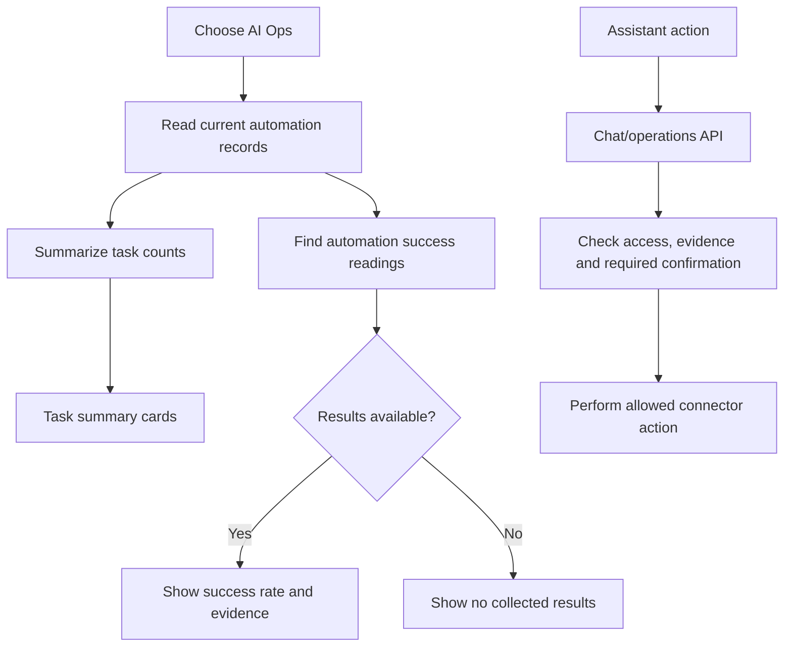
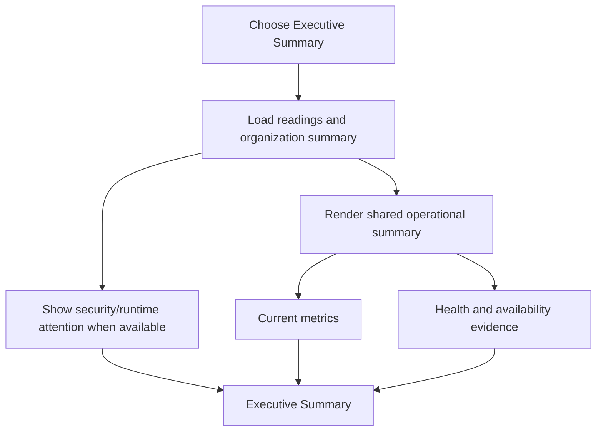
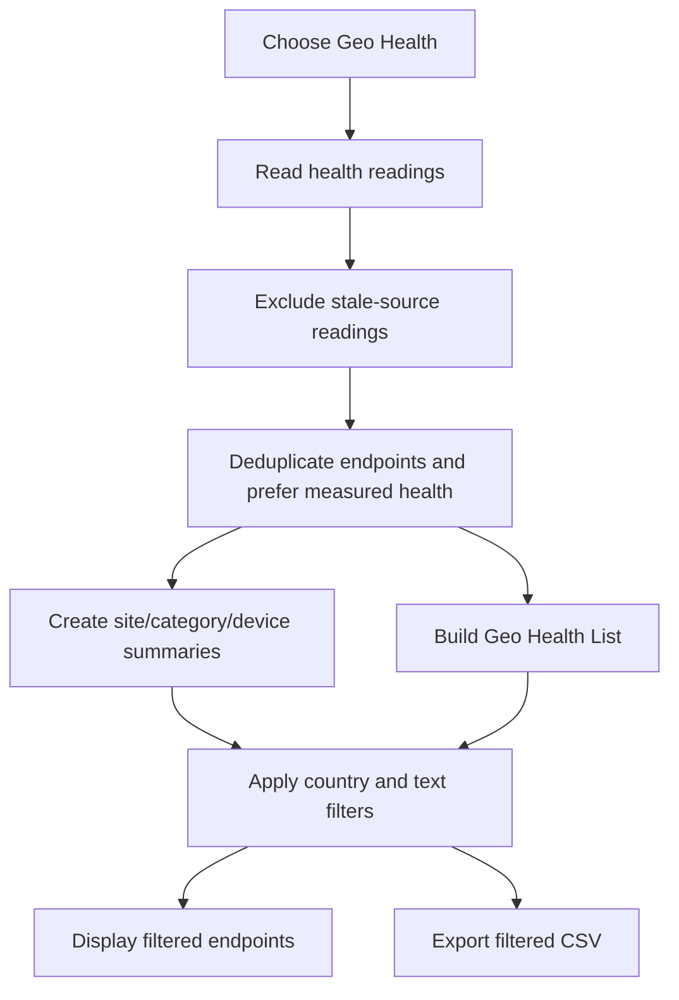
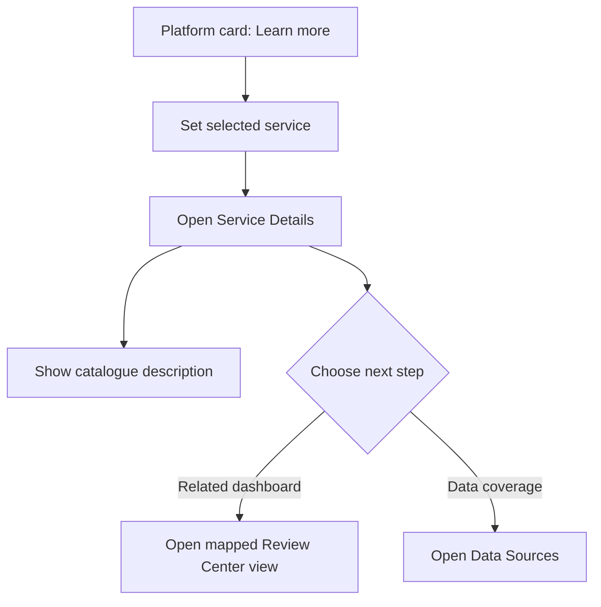
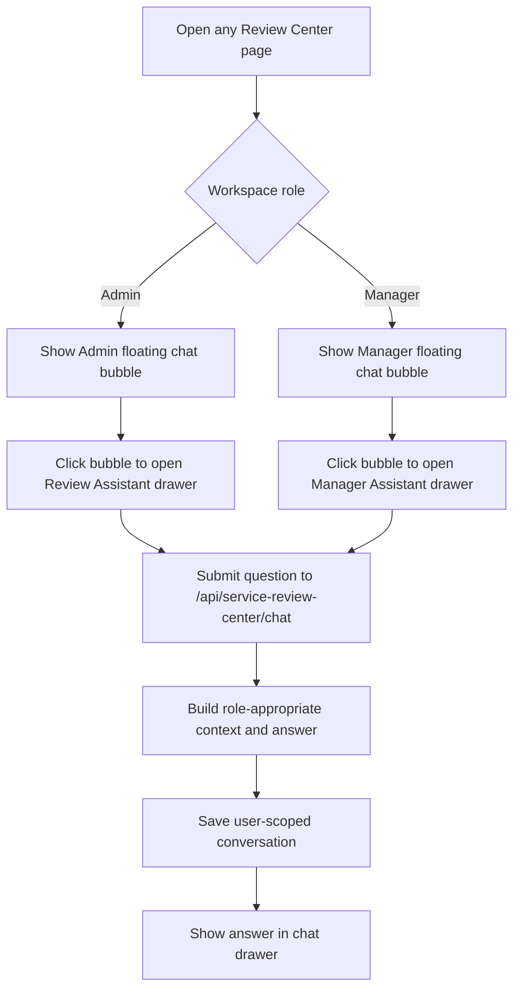

# AIForce.Ops Service Review Center — Page-by-Page File Map

This guide maps the **website header and each individual Service Review Center page** to the project files that implement it. Every page has its own file-location heading and flowchart. Paths in the trees are relative to the `ai-force-ops/` project root.

The Service Review Center is one signed-in application at `/service-review-center`. Its views are switched inside a shared React shell. Query parameters can choose an initial view, for example `/service-review-center?view=observability`.

## Access shared by all pages

```text
app/service-review-center/page.tsx
└── Checks sign-in and selects the initial view

app/api/workspace/access/route.ts
└── Returns the signed-in member's workspace role/access

app/api/service-review-center/records/route.ts
└── Allows active Admins and Managers to read the shared organization readings

lib/workspace-access.ts
lib/workspace-permissions.ts
└── Resolves workspace membership and permission rules
```

Admin and Manager have Review Center access. The Admin manages data connections. The Manager sees a read-only source overview. Employee and User roles do not have these Review Center pages; an employment-verified Employee can have a separate ePACE shortcut in Agent Studio.

---

## Header of the Website — file locations

This is the Review Center website header shown in the separate header screenshot: AIForce.Ops branding, “SaaS Service Review Center,” PostgreSQL reading status, appearance toggle, Help, and the signed-in account menu.

```text
app/service-review-center/
├── service-review-center.tsx
│   └── Header controls, reading-status badge, Help navigation, and workspace links
└── review-theme.css
    └── Header layout, colors, theme, and responsive styling

components/auth/WorkspaceUserMenu.tsx
└── Shared signed-in account menu

app/api/workspace/access/route.ts
└── Supplies the current member/role for role-aware workspace links

app/api/service-review-center/records/route.ts
└── Supplies the records/sources status displayed in the header badge
```

The PostgreSQL badge reflects whether Review Center readings loaded; it is not a separate database health probe. Help switches to Data Sources. The appearance toggle is held by the page component.



---

## Platform Page file locations

**View:** `services` · **Default:** `/service-review-center`

```text
app/service-review-center/
├── page.tsx
│   └── Opens the default Platform view
├── service-review-center.tsx
│   └── Platform title, service cards, Learn more and View dashboard actions
└── review-theme.css
    └── Platform card grid and responsive page layout

app/api/service-review-center/records/route.ts
└── Provides the shared connection banner's reading/source status
```

The six service cards are static catalogue entries in `service-review-center.tsx`. **Learn more** stores the selected card and opens Service Details. **View** changes to the mapped Value, Observability, AI Ops, or Executive Summary view. The cards do not provision products.



---

## Observability Page file locations

**View:** `observability`

```text
app/service-review-center/
├── service-review-center.tsx
│   └── Selects and supplies readings to the Observability page
├── operations-overview.tsx
│   └── Target/alert/incident cards, target health and availability samples
└── review-data.ts
    └── Reading types and latest-health endpoint deduplication

app/api/service-review-center/records/route.ts
└── Reads the shared organization readings and source status

lib/service-review/bridge.ts
└── Projects connected monitoring records into Review Center readings
lib/eassist/sync.ts
└── Refreshes connected Prometheus and Alertmanager data

db/migrations/0006_service_review_records.sql
db/migrations/0010_review_connectors.sql
└── Stores observations and their source/current-state metadata
```

The page uses fresh source records to show monitored/unavailable targets, alerts, incidents, health rows, and observed availability. Missing measurements stay blank; they are not counted as healthy or zero.



---

## Value Dashboard Page file locations

**View:** `value`

```text
app/service-review-center/
├── service-review-center.tsx
│   └── Defines the value metric keys and composes the page
├── review-data.ts
│   └── Shared Review Center reading types
└── review-theme.css
    └── Shared card and chart styling

app/api/service-review-center/records/route.ts
└── Supplies organization metrics and historical readings

lib/service-review/ingestion.ts
└── Validates and stores external business readings

db/migrations/0006_service_review_records.sql
└── Stores metric payloads and observation timestamps
```

The page displays source-supplied values for experience, automation, savings, innovation, benchmark, sustainability, technical debt, and customer satisfaction. It uses up to 12 observations for each metric's sparkline. It does not infer business outcomes from monitoring signals.



---

## AI Ops Page file locations

**View:** `aiops`

```text
app/service-review-center/
├── service-review-center.tsx
│   └── Selects AI Ops mode and supplies readings
├── operations-overview.tsx
│   └── Automation task counts and reported success results
├── review-assistant.tsx
├── manager-assistant.tsx
│   └── Role-specific assistant drawer that can answer operational questions
└── operations-control.tsx
    └── Diagnostics and confirmed recovery controls in the Admin assistant

app/api/service-review-center/
├── records/route.ts
│   └── Supplies collected task/automation readings
├── chat/route.ts
│   └── Answers assistant questions using permitted context
└── operations/route.ts
    └── Diagnostics and guarded, confirmed operational actions

lib/service-review/assistant-operations.ts
└── Builds operational snapshots/context
lib/eassist/sync.ts
└── Collects connected Semaphore task/workflow information
lib/eassist/actions.ts
└── Executes permitted connector actions after approval checks
```

The dashboard itself reports collected successful, failed, running, and pending tasks plus automation success results. Assistant-triggered actions are separate and subject to role, source, and confirmation checks.



---

## Executive Summary Page file locations

**View:** `executive`

```text
app/service-review-center/
├── service-review-center.tsx
│   └── Executive page title and organization application-health banner
├── operations-overview.tsx
│   └── Shared operational summary cards, target health and availability
└── review-data.ts
    └── Shared record types and freshness/deduplication helpers

app/api/service-review-center/records/route.ts
└── Supplies readings and the organization summary

lib/organization.ts
└── Builds organization-level application/security health summary

db/migrations/0013_platform_operations.sql
db/migrations/0039_organization_alerts.sql
└── Stores platform events and organization alert state
```

This view uses the operational summary component and adds blocked/failed security events and active runtime signals when available. Values still come from supplied readings; the page does not manufacture business outcomes.



---

## Data Sources Page file locations

**View:** `sources`

```text
app/service-review-center/
├── service-review-center.tsx
│   └── Chooses Admin controls or Manager read-only view
├── data-sources.tsx
│   └── Admin source status, Sync now, collector token and JSON import UI
├── manager-sources.tsx
│   └── Manager read-only organization source overview
└── eassist/
    └── Existing integration-management workspace

app/api/service-review-center/
├── records/route.ts
│   └── Reads source state; accepts validated manual/collector batches
├── sync/route.ts
│   └── Starts an Admin source refresh
└── token/route.ts
    └── Creates, reads, or revokes the signed-in Admin's collector token

app/api/eassist/
├── route.ts
├── worker/route.ts
├── webhook/route.ts
└── events/route.ts
    └── Connector operations, background collection, and change notifications

lib/eassist/sync.ts
lib/service-review/bridge.ts
└── Refreshes connectors and maps results into shared Review Center readings
lib/service-review/ingestion.ts
└── Validates, deduplicates, enriches, and stores submitted reading batches

db/migrations/0008_eassist.sql
db/migrations/0006_service_review_records.sql
db/migrations/0010_review_connectors.sql
db/migrations/0011_collector_heartbeat.sql
└── Stores connectors, readings, imports, tokens, sync state and worker heartbeat
```

Managers see source freshness and counts only; Admins maintain the integrations and credentials. Collector tokens are stored as hashes, shown only when created, and expire after 90 days. Batch ingestion requires a UUID `batchId` so identical retries are safe.

```mermaid
flowchart TD
    A[Choose Data Sources] --> B{Role}
    B -->|Admin| C[Show source controls]
    B -->|Manager| D[Show read-only source list]
    C --> E[Sync now]
    E --> F[POST /api/service-review-center/sync]
    F --> G[Refresh enabled eAssist connectors]
    G --> H[Reload readings and source status]
    C --> I[Create/revoke collector token]
    I --> J[/api/service-review-center/token]
    C --> K[Submit JSON readings]
    K --> L[Validate, deduplicate, enrich, store]
    D --> H
```

---

## Geo Health Page file locations

**View:** `geo`

```text
app/service-review-center/
├── service-review-center.tsx
│   └── Country/search filters, summary groups, and CSV export
├── geo-health-table.tsx
│   └── Device, IP, site, country, vendor, status and source details
├── review-data.ts
│   └── Picks latest health observation per normalized endpoint
└── review-theme.css
    └── Shared table and panel styling

app/api/service-review-center/records/route.ts
└── Supplies health readings and source freshness

lib/service-review/ingestion.ts
lib/service-review/enrichment.ts
lib/service-review/enrichment-model.ts
└── Validates health data and enriches public endpoint details

db/migrations/0017_review_enrichment.sql
└── Caches endpoint enrichment results
```

The list deduplicates by endpoint and prefers measured scrape-target health over a general API check. During ingestion, enrichment can resolve DNS, estimate public IP geography using `ipwho.is`, and create an AI description when configured. Private/loopback endpoints are not publicly geolocatable.



---

## Service Details Page file locations

**View:** `details`

```text
app/service-review-center/
├── service-review-center.tsx
│   └── Service catalogue entries, selected-service state, and details page
└── review-theme.css
    └── Shared catalogue/detail styling

app/api/service-review-center/records/route.ts
└── Supplies the shared readings banner; there is no details-only endpoint
```

The selected service and its explanatory copy come from the static `services` catalogue in `service-review-center.tsx`. The related-dashboard button opens a mapped view; data-coverage opens Data Sources. This page does not provision a separate service.



---

## Chat Button (bottom-right) — file locations

This is the **purple floating chat bubble shown at the bottom-right of your screenshot**. It stays visible across Review Center pages for Admins and Managers. Clicking it opens the role-specific chatbot drawer.

```text
app/service-review-center/
├── service-review-center.tsx
│   └── Renders the correct floating chatbot for the signed-in role
├── review-assistant.tsx
│   └── Admin chat bubble, chat drawer, conversation history, and assistant tools
├── manager-assistant.tsx
│   └── Manager chat bubble and organization-summary drawer
├── review-assistant.css
└── manager-assistant.css
    └── Chat drawer and message styling

app/api/service-review-center/chat/route.ts
└── Loads conversations and handles submitted chat messages

lib/service-review/assistant-operations.ts
lib/manager-review.ts
└── Builds role-appropriate operational context and answers

db/migrations/0018_review_chat.sql
db/migrations/0022_review_chat_conversations.sql
└── Stores user-scoped chat turns and conversation history
```

`service-review-center.tsx` mounts `ReviewAssistant` for Admins and `ManagerAssistant` for Managers. The floating button itself is the `Dialog.Trigger` in those two assistant components. The Admin drawer also links to operational and security tools; those tool panels use `operations-control.tsx`, `security-control.tsx`, and their corresponding API routes.



## Shared data flow behind the pages

```text
Connected eAssist sources
  → lib/eassist/sync.ts
  → lib/service-review/bridge.ts
  → service_review_records / eassist_records in PostgreSQL
  → GET /api/service-review-center/records
  → shared state in service-review-center.tsx
  → each page renders the record types it uses

External collector
  → POST /api/service-review-center/records
  → lib/service-review/ingestion.ts validates batch and readings
  → enriches health endpoints when applicable
  → stores records in PostgreSQL
```

The readings endpoint refreshes every five seconds while the page is open. Admin views also initiate source sync and listen for connector change events. The Manager sees the shared organization view without source-maintenance controls.

